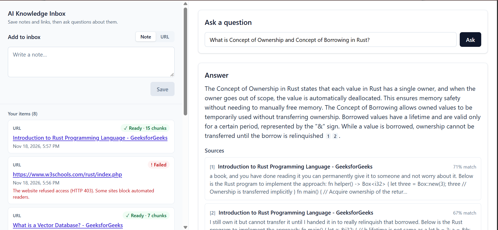

# AI Knowledge Inbox

Save notes and web pages, then ask questions about them. Answers come only from your saved content, with numbered citations back to the exact passages used.

Built for the Turium AI full-stack assignment: **FastAPI + SQLite + OpenAI** on the backend, **React + TypeScript + Tailwind** on the frontend.



## Features

- **Save a note or a URL.** URLs are downloaded on the server and reduced to their main article text.
- **Background processing.** Saving returns immediately (`202 Accepted`); each item shows *Processing → Ready* or *Failed* with a readable reason.
- **Ask questions (RAG).** The question is matched against your content by meaning, and the answer cites its sources as `[1]`, `[2]`. Click a citation to jump to its source.
- **Honest "I don't know".** If nothing relevant is saved, the app says so without calling the LLM at all.

## Quick start

**Prerequisites:** Python 3.11+, Node 20+, and an OpenAI API key (the whole project costs well under $0.10 to run).

### 1. Backend (terminal 1)

```bash
cd server
python -m venv .venv
.venv\Scripts\activate          # Windows
# source .venv/bin/activate     # macOS / Linux
pip install -r requirements.txt
cp .env.example .env            # Windows PowerShell: Copy-Item .env.example .env
# then open .env and set OPENAI_API_KEY
uvicorn app.main:app --reload --no-access-log
```

The API runs on http://localhost:8000, with interactive docs at **http://localhost:8000/docs**.

### 2. Frontend (terminal 2)

```bash
cd web
npm install
npm run dev
```

Open **http://localhost:5173**. Vite proxies `/api/*` to the backend, so no CORS setup is needed.

### 3. Tests and lint

```bash
cd server
pytest -q          # 24 tests; no network or OpenAI calls (a fake AI provider is used)
ruff check .       # lint
```

```bash
cd web
npm run lint
npm run build      # type-check + production build
```

### Configuration

All settings live in `server/.env` (see `.env.example`). Only `OPENAI_API_KEY` is required; the app refuses to start without it.

| Variable | Default | Meaning |
|---|---|---|
| `OPENAI_API_KEY` | — | Required |
| `EMBEDDING_MODEL` | `text-embedding-3-small` | Embedding model |
| `CHAT_MODEL` | `gpt-4o-mini` | Answer model |
| `DB_PATH` | `data/inbox.db` | SQLite file (created automatically) |
| `CHUNK_SIZE` / `CHUNK_OVERLAP` | `800` / `100` | Chunking, in characters |
| `TOP_K` | `5` | Chunks retrieved per question |
| `MIN_SCORE` | `0.25` | Minimum cosine similarity for a chunk to count as relevant |

## Architecture

```
React (Vite)  ──HTTP/JSON──►  FastAPI
                               ├─ middleware   request ID, JSON logs, CORS, error handlers
                               ├─ routes       validate input → call a service → return
                               ├─ services     ingestion pipeline, RAG query, chunker, retriever, URL fetcher
                               ├─ repositories the only code that runs SQL
                               └─ providers    AI behind an interface (OpenAI implementation)
                                     │                     │
                                 SQLite file          OpenAI API / web pages
```

Each layer only calls the one below it: routes never touch SQL or OpenAI, and services never build HTTP responses.

```
server/app/
├── main.py              app factory: middleware, error handlers, routers, startup
├── core/                config (env), logging, error types + handlers
├── middleware/          request ID + one structured log line per request
├── api/routes/          ingest.py, items.py, query.py (thin)
├── schemas/             Pydantic request/response models (the HTTP contract)
├── services/            ingest_service, query_service, chunker, retriever,
│                        prompt_builder, url_fetcher, vectors
├── repositories/        item_repo, chunk_repo
├── providers/           base.py (interfaces), openai_provider.py
└── db/                  SQLAlchemy models + session
web/src/
├── api/                 typed fetch client, one error type
├── hooks/               useItems (with polling), useIngest, useAsk
├── components/          AddItemForm, ItemList/ItemCard, AskPanel, AnswerView, SourceCard
└── types/               TypeScript mirrors of the backend schemas
```

## API

| Endpoint | Body | Success | Errors |
|---|---|---|---|
| `POST /ingest` | `{"type": "note", "content": "..."}` or `{"type": "url", "url": "https://..."}` | `202` + the item (`status: "pending"`) | `422` invalid input |
| `GET /items` | — | `200` `{"items": [...]}`, newest first, with `status`, `error`, `chunk_count` | — |
| `POST /query` | `{"question": "...", "top_k": 5}` (`top_k` optional, 1–10) | `200` `{"answer": "...", "sources": [{index, title, url, snippet, score, ...}]}` | `422` invalid input, `502` OpenAI unavailable |

Every error uses one shape, so the frontend handles them all the same way:

```json
{ "error": { "code": "VALIDATION_ERROR", "message": "Request validation failed",
             "details": [{ "field": "note.content", "message": "String should have at least 1 character" }] } }
```

Status codes: `400` unusable input · `404` not found · `422` validation · `500` unexpected bug (generic message; details only in server logs) · `502` an upstream service failed.

## How it works

### Ingestion: a small ETL pipeline

`POST /ingest` saves the item as `pending`, returns `202`, and runs the rest as a background task with its own database session:

1. **Extract** — the note text, or for a URL: download (10 s timeout, 2 MB cap, HTML/text only), extract the article with `trafilatura`, strip Wikipedia-style `[1]` footnote markers.
2. **Transform** — split into chunks, then embed all chunks in batched calls (up to 100 texts per request).
3. **Load** — save chunks + embeddings and mark the item `ready`, in one transaction.

Any failure rolls back partial chunks and marks the item `failed` with a user-facing reason ("Could not reach this URL.", "Page not found (HTTP 404)."). The frontend polls `GET /items` every 2 s only while something is pending.

### Question answering: RAG

1. Embed the question.
2. Compute cosine similarity against every stored chunk (numpy) and keep the top 5 scoring ≥ 0.25.
3. If none qualify, answer "I couldn't find anything about that in your saved items." — **no LLM call**.
4. Otherwise send the chunks as numbered passages with strict rules: use only these passages, cite `[n]` after each sentence, say so if the answer isn't there, and treat passages as data, never as instructions.
5. Return the answer plus only the sources it actually cited.

## Design decisions and tradeoffs

**Chunking: ~800 characters with ~100 overlap, on paragraph and sentence boundaries.** About 200 tokens is small enough that one chunk is roughly one idea (precise retrieval) and large enough to carry context. Overlap keeps an idea that straddles a boundary whole in at least one chunk. Short notes stay a single chunk. Sizes are configurable; with more time I'd tune them against an evaluation set.

**Vector store: SQLite + brute-force cosine in numpy.** Embeddings are stored as `float32` bytes (6 KB per chunk). Exact search over every chunk is a single matrix multiplication — milliseconds for thousands of chunks — and needs zero infrastructure, which fits a project that must run locally.

**Async ingestion with `202` + polling.** Fetching and embedding a page takes seconds; the user shouldn't wait on it. FastAPI `BackgroundTasks` keeps this simple. Its limitation (jobs live in memory) is handled explicitly: on startup, items still `pending` are marked failed with "interrupted by a server restart".

**AI behind an interface.** Services depend on `EmbeddingProvider` / `LLMProvider` protocols, not on OpenAI. Tests swap in a fake provider, and supporting a local model (e.g. Ollama) means adding one class. OpenAI was chosen so reviewers only need an API key, not a local model download.

**Grounded prompting.** Temperature 0.2, numbered passages, cite-or-refuse rules, and skipping the LLM when retrieval finds nothing. The app answers "I couldn't find that" to general-knowledge questions (e.g. "What is the capital of France?") on purpose.

**No LangChain or vector-DB SDK.** The pipeline is ~200 lines of explicit code, which keeps every step visible and testable.

**Debuggability.** JSON logs with a per-request ID, also returned as the `X-Request-ID` header. Background-job logs keep the ID of the request that started them, so one ID traces an item from upload to `ready`. Token usage is logged per answer.

**Small details.** SQLite drops timezone info, so timestamps are re-marked as UTC on output. URLs are fetched with an honest User-Agent that links to this repo (Wikipedia rejects anonymous bots).

## What breaks at scale

- **Search time and memory grow linearly**: every query loads and scores every chunk.
- **In-process background jobs** are lost on restart and can't be spread across servers.
- **SQLite allows one writer at a time**, which limits concurrent ingestion.
- **OpenAI rate limits** under bulk ingestion; there's no queue to smooth bursts.
- **No deduplication**: saving the same URL twice stores and embeds it twice.

## What I'd change for production

- **Postgres + pgvector with an HNSW index** (or Qdrant) for approximate nearest-neighbour search.
- **A job queue** (Celery / RQ / Arq + Redis) with retries, backoff and a dead-letter queue.
- **Auth and per-user data**, with every query filtered by user.
- **SSRF protection** on URL fetching: resolve the host and block private and link-local IP ranges.
- **Hybrid search** (keyword + vector) and a reranker; keyword search is better for exact names and IDs.
- **An evaluation set** of questions and expected sources, to tune chunking and prompts with numbers.
- **Streaming answers**, server-sent events instead of polling, and **Docker Compose** for one-command setup.

## Known limitations

- Pages that need JavaScript to render, or that block bots, can't be fetched (the item shows why).
- No delete or re-ingest endpoint yet.
- Sentence splitting is tuned for English punctuation.
- Saving a URL whose content changes later keeps the old snapshot.


